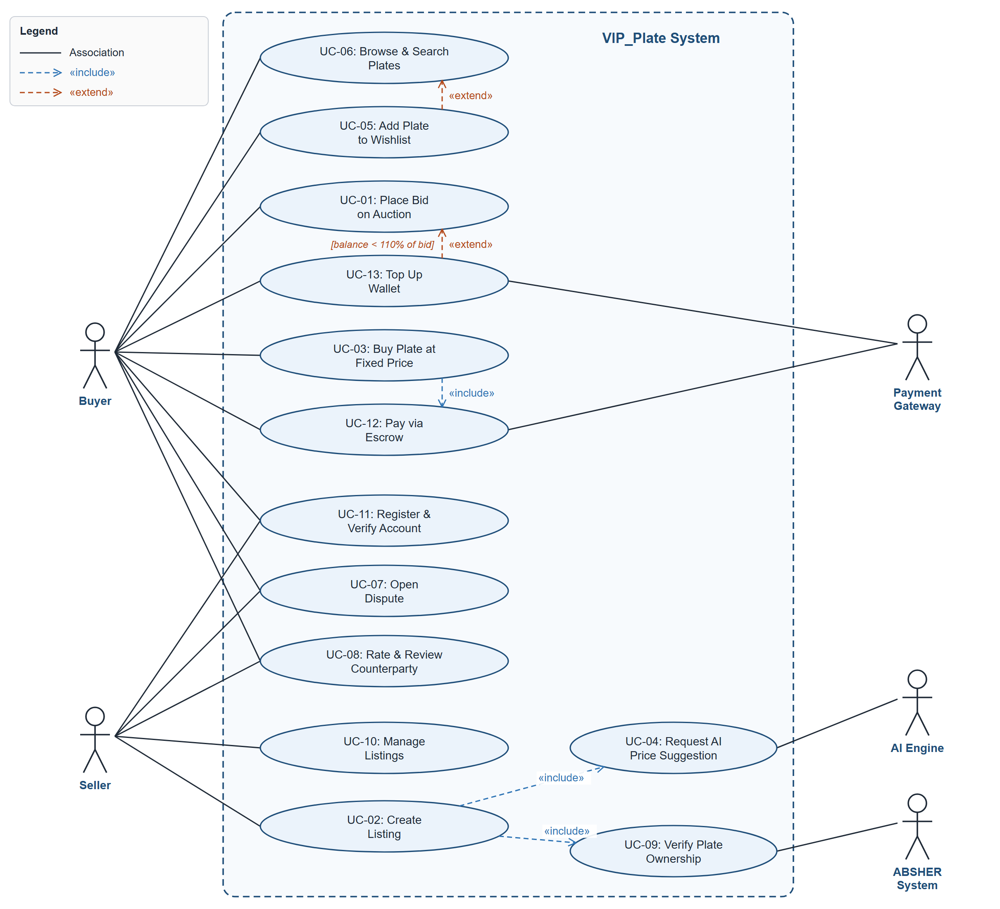
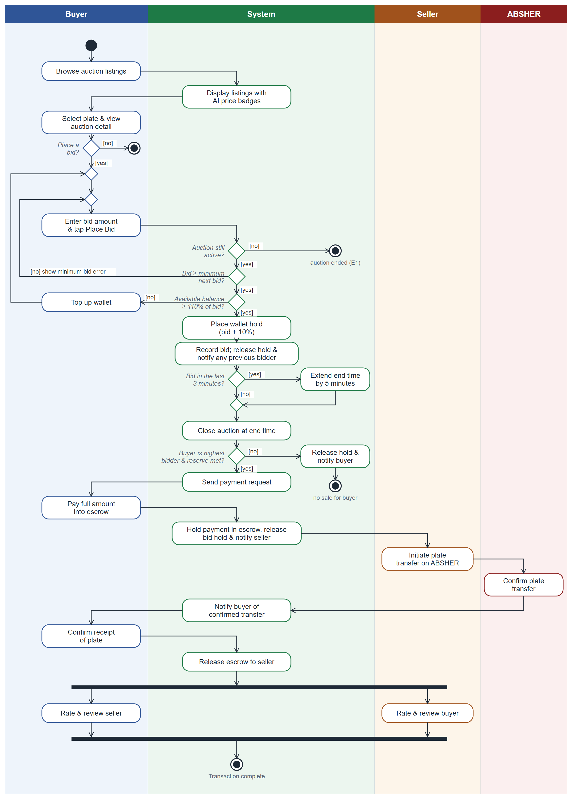
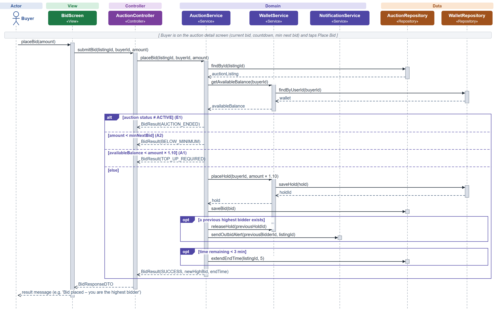
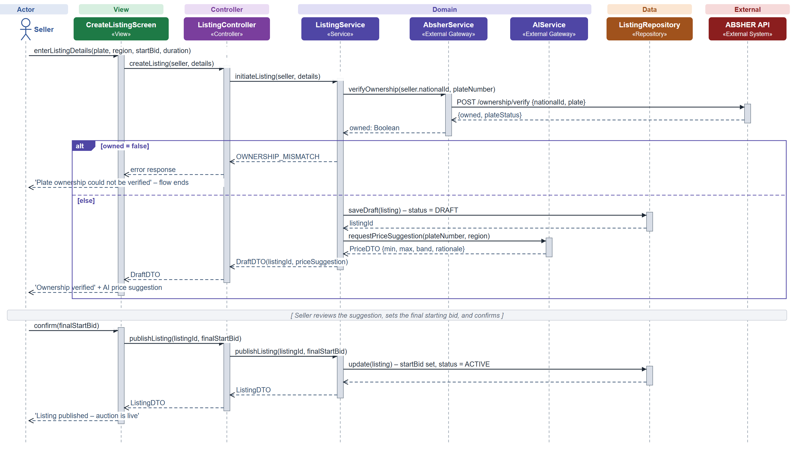
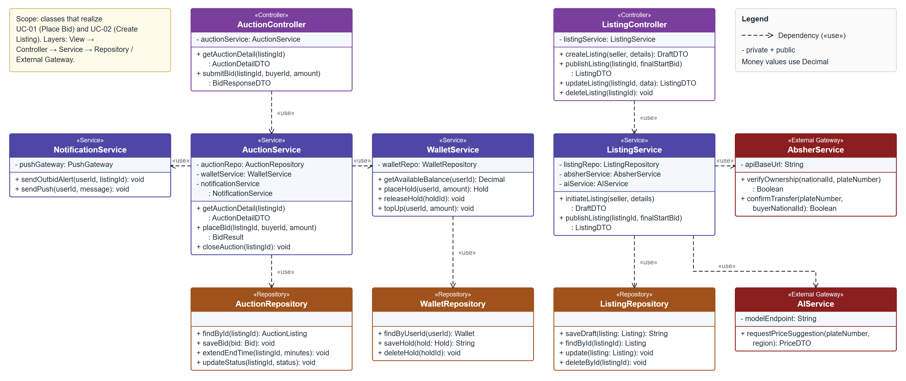
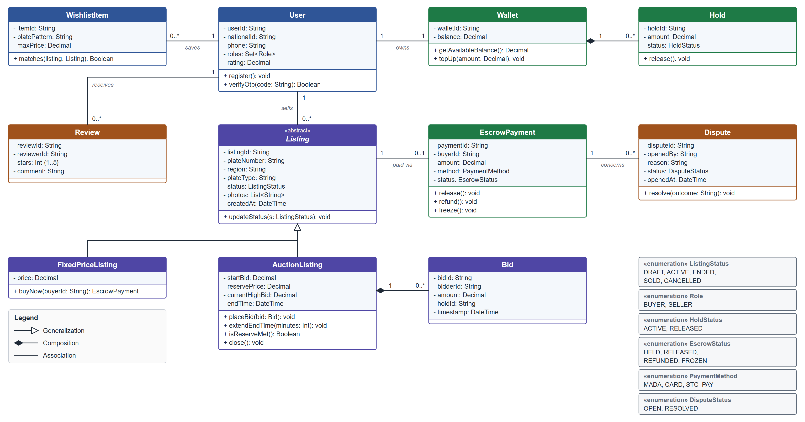

# VIP_Plate — License Plate Marketplace (System Analysis & Design)

A mobile marketplace for buying, selling, and auctioning license plates in Saudi Arabia. It is designed around verified identities, ABSHER ownership checks, real-time auctions with wallet holds, AI-assisted pricing, and escrow payments.

> **Academic team project.** Course: IS340 System Analysis and Design (2), King Saud University.
> **Scope:** analysis and design only (requirements, UML models, test design). The project has no implementation.

📄 **Full report:** [PDF](docs/VIP_Plate_Report.pdf) · [Word (editable)](docs/VIP_Plate_Report.docx) (18 pages)

---

## The problem

Plate trading in Saudi Arabia happens mostly in social media groups and general classifieds. Buyers and sellers face fraud, unclear pricing, and slow negotiations, and no single platform combines buying, selling, and auctions in a secure, verified flow.

## The solution

| Feature | How it works |
|---|---|
| **Verified users** | National ID + OTP registration |
| **Ownership checks** | Every listing is verified against the ABSHER API before it is saved |
| **Real-time auctions** | 5% minimum increment, optional reserve price, and anti-sniping (a bid in the last 3 min extends the auction by 5 min) |
| **Wallet holds** | Each bid holds the bid amount + 10%; the hold is released when the bidder is outbid |
| **AI price suggestion** | Returns a price range (min–max) and band (low / fair / premium) based on plate pattern, rarity, and comparable sales |
| **Escrow payments** | Funds are released only after ABSHER confirms the plate transfer and the buyer confirms receipt |
| **Trust & safety** | Two-way ratings and a dispute process with a 72-hour SLA |

---

## What's in the report

| Part | Deliverable |
|---|---|
| 1 | **Product Requirements Document:** background, measurable goals, scope, stakeholders, feature mechanics, 11 functional requirements |
| 2 | **Use case model:** 13 use cases, FR → UC traceability matrix, a fully dressed use case (UC-01 Place Bid), and an activity diagram |
| 3 | **Sequence diagrams:** Place Bid and Create Listing, with `alt`/`opt` fragments for the alternate and exception flows |
| 4 | **Design class diagrams:** MVC + Repository application layer and the domain model |
| 5 | **Functional test cases:** black-box tests derived from the acceptance criteria |

---

## Diagrams

### Use Case Diagram

### Activity Diagram: Complete Plate Purchase via Auction

### Sequence Diagram: Place Bid (UC-01)

### Sequence Diagram: Create Listing (UC-02)

### Class Diagram: Application Layer (MVC + Repository)

### Class Diagram: Domain Model

---

## Design highlights

- **Layered architecture:** View → Controller → Service → Repository, with gateway classes wrapping external systems (ABSHER, AI microservice).
- **End-to-end consistency:** every requirement traces to a use case. Every operation called in the sequence diagrams is defined on the receiving class in the class diagrams.
- **Explicit failure paths:** auction ended, bid below minimum, insufficient balance, and ownership mismatch are all modeled in both the use case and the sequence diagrams.
- **Domain modeling:** composition for lifecycle-bound parts (Auction → Bids, Wallet → Holds), generalization for listing types, and `Decimal` for all money values.

## Skills demonstrated

Requirements engineering · UML 2.5 (use case, activity, sequence, class) · Object-oriented design · MVC / Repository pattern · Requirements traceability · Test case design
